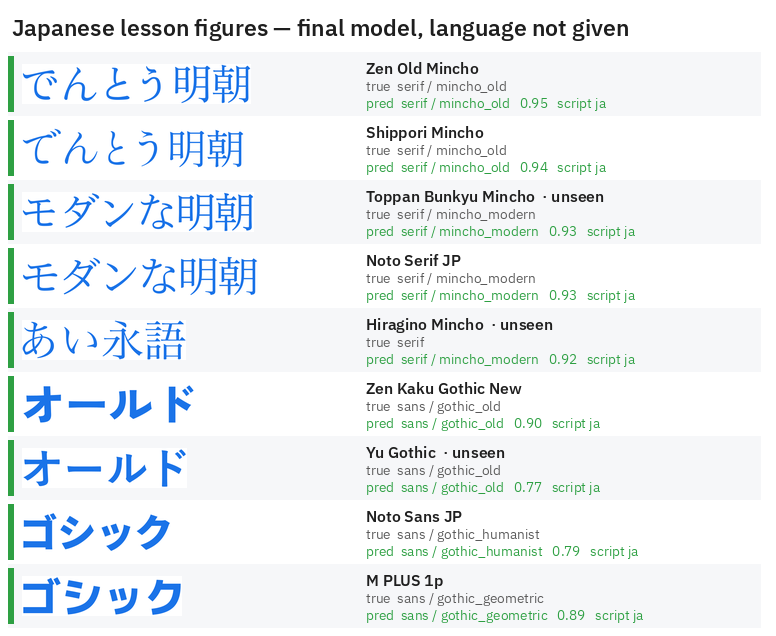
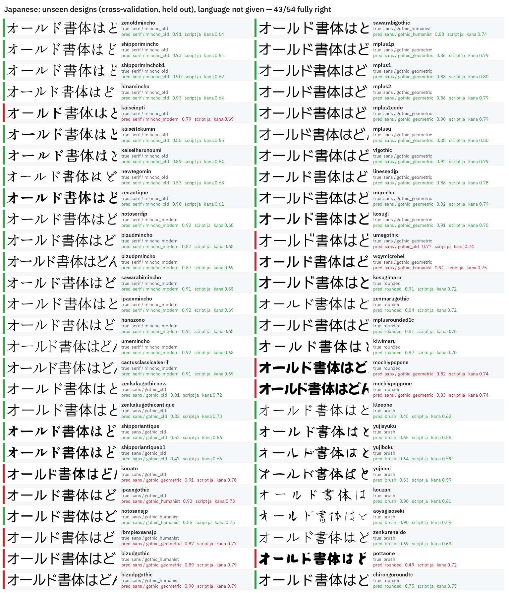
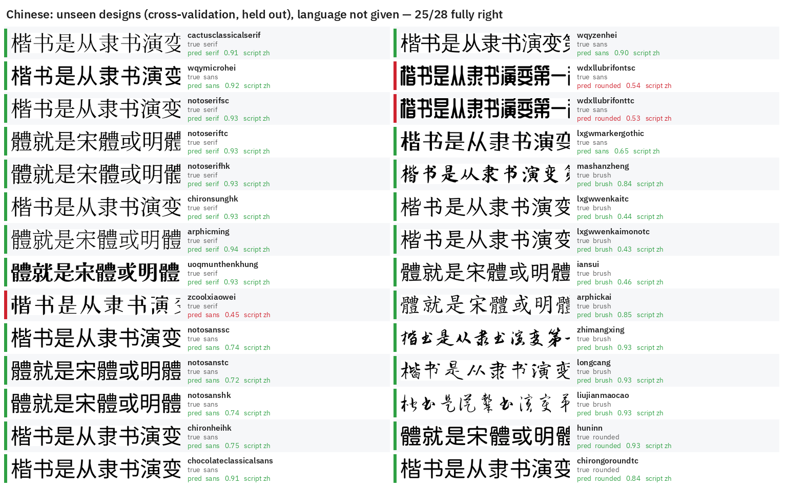
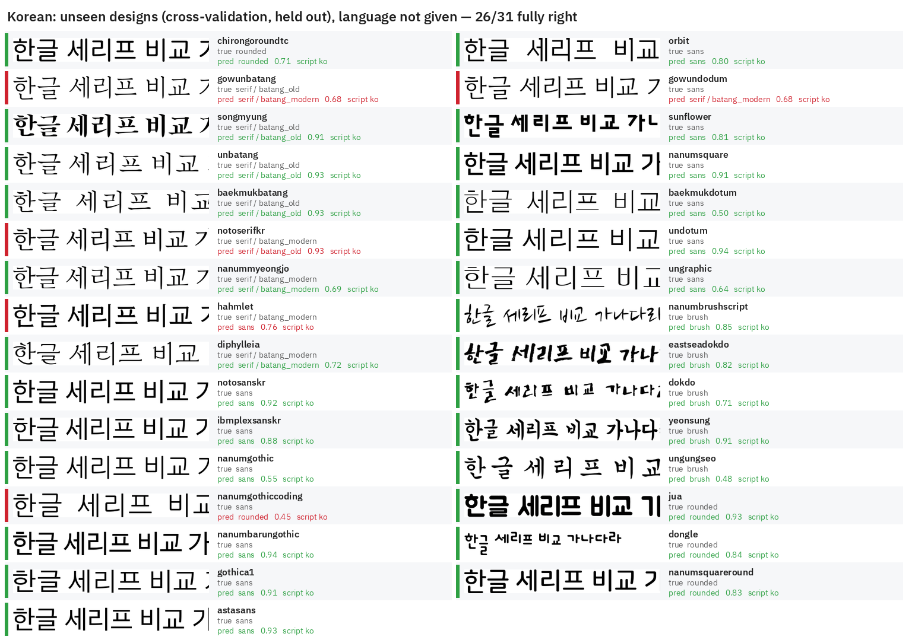
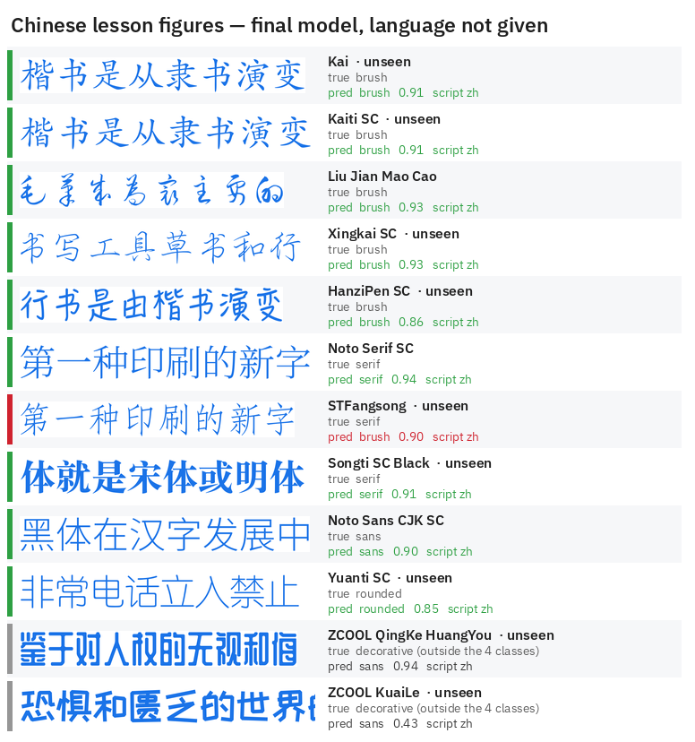
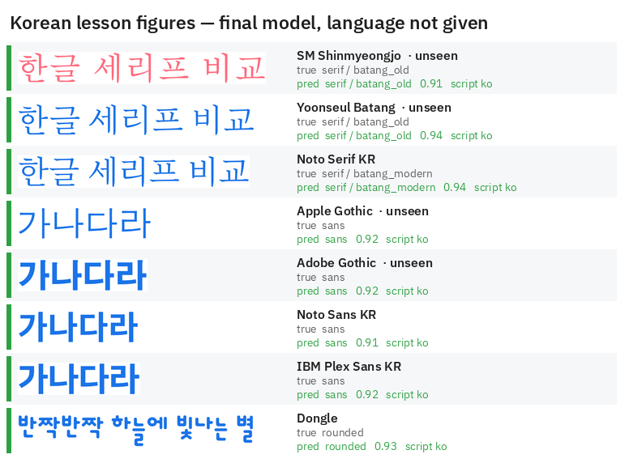

# tinyFC_cjk — a tiny CJK typeface classifier

A ~0.7M-parameter CNN that classifies an image of one horizontal line of Chinese,
Japanese or Korean text. You don't tell it the language; it reads the script itself.
It follows Google Fonts Knowledge, *Type classification in CJK*:
[Chinese](https://fonts.google.com/knowledge/type_in_china_japan_and_korea/type_classification_in_cjk_chinese),
[Japanese](https://fonts.google.com/knowledge/type_in_china_japan_and_korea/type_classification_in_cjk_japanese),
[Korean](https://fonts.google.com/knowledge/type_in_china_japan_and_korea/type_classification_in_cjk_korean).



## Design

One shared model, several heads on one backbone:

| head | classes | trained on |
|---|---|---|
| **coarse** (all languages) | `serif` 宋体/明朝/명조 · `sans` 黑体/ゴシック/고딕 · `brush` 楷体·行书/楷書·毛筆/궁서·붓 · `rounded` 圆体/丸ゴシック/둥근 | every font |
| **script** | `ja` kana-mixed · `zh` Han only · `ko` Hangul | every line; picks the fine head |
| **fine ja/serif** | `mincho_old`, `mincho_modern` | 6 vs 7 designs |
| **fine ja/sans** | `gothic_old`, `gothic_humanist`, `gothic_geometric` | 4 / 4 / 6 designs |
| **fine ko/serif** | `batang_old`, `batang_modern` | 4 vs 4 designs |
| **kana ratio** (aux) | regression: ink area of kana ÷ kanji at Regular weight | Japanese lines |

Prediction: coarse class = argmax of the coarse head. The fine head is the one for
(predicted script, predicted coarse class), if it exists.

A fine head exists only when **every** subclass has at least `MIN_FINE_GROUPS = 4`
distinct designs. `taxonomy.enabled_fine_heads()` checks this from the font list.
Candidates that fall short stay off:

| candidate | designs per class | state |
|---|---|---|
| ko/sans `dotum_old_square` vs `dotum_modern` | 3 vs 10 | off: only Baekmuk, UnDotum, UnGraphic are full-square |
| zh/brush `kaiti` vs `xingcao` | 3 vs 3 | off |
| zh/serif `songti` vs `fangsong` | 4 vs 0 | off: no free FangSong font |

"Design" means a design group: fonts that share outlines count once, across
languages too. Noto Sans SC/TC/HK/JP/KR, Chiron Hei HK and Chocolate Classical Sans
are all Source Han Sans. M+ and VL Gothic share kana. Kosugi, Kosugi Maru and Huninn
are all Motoya. Klee One, LXGW WenKai and Iansui are one design.
Cross-validation always holds out whole groups.

## Data

* 135 CJK families from google/fonts and 24 more designs from Debian packages
  (see [fonts/SOURCES.md](fonts/SOURCES.md)). 109 fonts, 310 faces and 71 design
  groups are used. Display/novelty faces, kana-only fonts and Bopomofo-annotated
  fonts are left out.
* Labels are in [taxonomy.py](src/tinyfc_cjk/taxonomy.py). `source="article"`
  means the lesson names or shows the font as an example of that class; everything
  else is my call against the lessons' criteria.
* Rendering ([render.py](src/tinyfc_cjk/render.py)): random lines from fixed
  pools (JIS X 0208 level 1 + kana, GB2312 level 1, Big5 common, KS X 1001 Hangul),
  limited per face to characters it has, so there is never tofu. Japanese fonts also
  give Han-only lines (15 %). Augmentation: size, tracking, squash, crop, blur, low
  resolution, contrast, noise. Sampling is balanced over coarse class → language →
  fine class → design group → face.

### Japanese old-style and geometric Gothic

Google Fonts has only Zen Kaku and Shippori Antique as old-style Gothics, and M+ and
LINE Seed as geometric ones. To label more designs consistently I measured the
article's own criterion ("small counters and letter size" vs "prominently larger
counters and letter size"): the **ink-box area of kana ÷ that of kanji at Regular
weight** ([research/jp_gothic_traits.py](research/jp_gothic_traits.py)). The
article's examples anchor it:

| | old | humanist | geometric |
|---|---|---|---|
| article example | Zen Kaku Gothic New **0.64** | Noto Sans JP **0.75** | M PLUS 1p **0.79** |
| others | Shippori Antique 0.65, Konatu 0.70, IPAex Gothic 0.72 | IBM Plex 0.76, BIZ UD 0.75, Sawarabi 0.75 | Murecho 0.80, Kosugi 0.80, Ume Gothic 0.74–0.91, WQY MicroHei 0.80, LINE Seed 0.77 |

Mincho splits the same way: old 0.56–0.66 (Zen Old 0.59, Shippori 0.61) and
modern 0.66–0.76 (Noto Serif JP 0.67, plus IPAex Mincho, Hanazono, Ume Mincho and
Cactus Classical Serif).

That gives old Gothic 4 designs, geometric 6 and modern Mincho 7. VL Gothic measures
identical to M+ (0.790 vs 0.789), and Chocolate Classical Sans has exactly the Source
Han kana, so they belong to those groups and are not new designs.

The ratio grows with weight (Noto Sans JP 0.73 at Thin, 0.81 at Black), so the
classes overlap face by face. Only the Regular-weight value separates them. The
model therefore regresses the *design's* Regular-weight value from any weight, as an
auxiliary target.

## Results

All results below are produced **without giving the model the language**.

### Cross-validation on unseen designs

4 folds, whole design groups held out, 10k steps each. "Font" means the average
over 120 random crops of one held-out font in one language. A wrong coarse class
counts as a wrong fine class. Data: [results/cv_auto.json](results/cv_auto.json);
the run without the kana-ratio head is in [results/cv.json](results/cv.json).

| per unseen font | without ratio head | **final setup** |
|---|---|---|
| script → right fine head | 113/113 | **113/113** |
| coarse | 102/113 (90 %) | **104/113 (92 %)** |
| fine ja/serif | 16/17 | 16/17 |
| fine ja/sans | 13/22 | **15/22** |
| fine ko/serif | 5/8 | 5/8 |
| everything right | 91/113 | **94/113** |
| kana ratio, predicted vs measured | — | r = 0.74–0.90, MAE 0.03–0.06 |

Each held-out font with its prediction. Green: coarse class and fine class (if any)
right; red: something wrong.





* **Coarse errors** are mostly display-like faces: Mochiy Pop (heavy rounded → sans),
  Potta One (brush → rounded), WDXL Lubrifont (sans → rounded), Hahmlet (a
  low-contrast serif → sans), ZCOOL XiaoWei, Gowun Dodum and Nanum Gothic Coding.
* **ja/serif** works (16/17). The miss is Kaisei Opti.
* **ja/sans** gets old-style Zen Kaku and Shippori Antique and all geometric M+, LINE
  Seed, Murecho and Kosugi. It confuses humanist and geometric: BIZ UD and IBM Plex
  become geometric, because the bands are close (humanist 0.745–0.755, geometric from
  0.77). Konatu, IPAex Gothic, Ume Gothic and WQY MicroHei are also wrong.
* **ko/serif** is 5/8, and two misses are the lesson's own examples: Gowun Batang
  held out → modern, Noto Serif KR held out → old. With 4 designs per side, one held
  out leaves 3. Treat it as a hint.

### The lessons' figures (real images, final model)

52 text lines cut from the three lessons' figures
([research/figure_lines/](research/figure_lines), labels in
[research/figure_labels.json](research/figure_labels.json)), averaged per font.
Most are system fonts the model never saw ([results/figures.json](results/figures.json)).
**Unseen fonts: coarse 13/14, fine 4/4. Script: right on every line.**




The Japanese figures are at the top of this page.

* The only miss is **STFangsong → brush**. FangSong's slanted, sharp strokes look
  Kai-like, and there is no FangSong font to train on.
* Toppan Bunkyu Mincho, Yu Gothic, SM Shinmyeongjo and Yoonseul Batang are unseen
  system fonts, and all get the right fine class.
* The ZCOOL faces are decorative, outside the four classes (grey).
* The kana ratio alone also gives the right fine class for every Japanese font
  except Toppan Bunkyu, whose ratio (0.64) sits on the old side of the 0.652 cut. The
  fine head gets it right.

## Usage

### Setup

```bash
uv sync --extra onnx                  # .venv: torch 2.11 (CUDA 12.8), Pillow, numpy, fontTools, onnx/onnxruntime
./run.sh scripts/fetch_fonts.py       # ~1.4 GB of fonts with their licences -> fonts/ (needs git + network)
```

Fonts are not in the repository. `fetch_fonts.py` downloads exactly the fonts in
[taxonomy.py](src/tinyfc_cjk/taxonomy.py): Google Fonts families from google/fonts,
and the other designs from Debian packages (see [fonts/SOURCES.md](fonts/SOURCES.md)).
`--only <ids>` fetches a subset. You only need fonts to train, run cross-validation,
or use `predict --font`; `predict` on images and the ONNX model work without them.

`run.sh` runs Python from `.venv` with `PYTHONPATH=src`. To use a different
interpreter, put `TINYFC_PYTHON=/path/to/python` in a git-ignored `.env.local`.

### Commands

```bash
# data and labels
./run.sh -m tinyfc_cjk.taxonomy                     # class/design counts, which fine heads are on, CV folds

# training
./run.sh -m tinyfc_cjk.train --cv --tag _auto       # 4-fold design-held-out CV -> results/cv_auto.json,
                                                    #   fold models -> models/cv_fold{0..3}_auto.pt
./run.sh -m tinyfc_cjk.train --steps 15000          # final model on all fonts -> models/tinyfc_cjk.pt
                                                    #   --trait-w 0 turns the kana-ratio head off

# prediction (the language is detected; --lang only overrides it)
./run.sh -m tinyfc_cjk.predict line.png             # one cropped horizontal text line
./run.sh -m tinyfc_cjk.predict --font X.otf --lang ko   # render samples with a font file
./run.sh -m tinyfc_cjk.predict --figures            # score the lessons' figure lines -> results/figures.json

# README images
./run.sh -m tinyfc_cjk.gallery                      # docs/figures_{zh,ja,ko}.png, docs/heldout_{ja,zh,ko}.png
```

* `predict` converts to grayscale, inverts light-on-dark, crops to the ink, slides
  windows over long lines and averages them. It prints the coarse class, the
  predicted script, the fine class when that script has a head for that coarse
  class, and for Japanese the predicted kana ratio with the class those cuts imply.
* In `results/cv_auto.json` every held-out font has `pred` (coarse), `script_pred`,
  `auto_fine` (the fine class reached without a language hint), `ratio_pred` and the
  true labels.
* `gallery` uses the final model for the figure lines and `results/cv_auto.json` for
  the held-out fonts, so run it after both trainings.

### ONNX

```bash
./run.sh -m tinyfc_cjk.export_onnx                  # -> models/tinyfc_cjk.onnx (2.8 MB) + models/tinyfc_cjk.json
python predict_onnx.py line.png                     # standalone: numpy + Pillow + onnxruntime, no torch
```

* Input `image`: float32 `[N, 1, 64, 256]`, ink = `1 - gray/255` (dark text on light paper).
  The line is scaled to 75 % of the height and centred; long lines are cut into
  overlapping 256-px windows. [predict_onnx.py](predict_onnx.py) has the ~30-line
  preprocessing to copy into other runtimes.
* Outputs (softmax already applied): `coarse [N,4]`, `script [N,3]`,
  `fine_ja_serif [N,2]`, `fine_ja_sans [N,3]`, `fine_ko_serif [N,2]`, `kana_ratio [N]`.
  Average them over a line's windows. Then use the fine output whose (language,
  coarse class) matches argmax(`script`) and argmax(`coarse`); `predict_onnx.py` does this.
* Class names, the kana-ratio cuts and usage notes are in `models/tinyfc_cjk.json`
  and in the model's `metadata_props["tinyfc_cjk"]`.
* Opset 17, dynamic batch. Checked against PyTorch in onnxruntime 1.32: max |diff| 3e-7.

## Licence

[MIT](LICENSE) for the code, the labels, the trained models and the result files,
**except** the images derived from the lessons' figures.

* Class definitions and the figures in `research/figs/`, `research/figure_lines/`,
  `research/{cn,jp,kr}_all.png`, `research/figure_lines_sheet.png` and
  `docs/figures_*.png` come from Google Fonts Knowledge, *Type classification in CJK*
  (Chinese, Japanese and Korean lessons). They are licensed
  [CC BY-SA 4.0](https://creativecommons.org/licenses/by-sa/4.0/), and those images
  stay under that licence (see [LICENSE](LICENSE)).
* Fonts are not included. They keep their own licences (OFL, Apache, IPA, Arphic, GPL
  and others; see [fonts/SOURCES.md](fonts/SOURCES.md) and the licence file in each
  downloaded folder). The model was trained on renders of them, including
  GPL-licensed WenQuanYi Zen Hei and the Un fonts.

## Next steps that would help most

1. More Japanese humanist and old-style Gothic designs, ideally commercial ones
   (Yu Gothic, Hiragino, Shin Go, Gothic MB101). The humanist vs geometric line is
   where most fine errors are.
2. Korean: one or two more modern text serifs (e.g. MaruBuri, RIDIBatang) and
   old-style serifs (KoPub Batang, Chosun Myeongjo) would make ko/serif reliable. Two
   more full-square sans would switch on ko/sans.
3. Chinese: one more Kai and one more cursive design switch on zh/brush. A free
   FangSong (e.g. the Taiwan MOE or CNS 11643 fonts) would allow songti vs fangsong.
